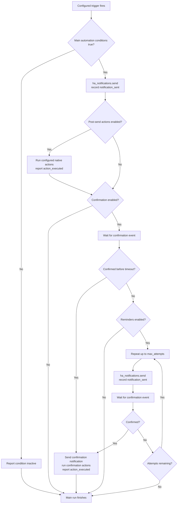

# Automation Flow

## Notification Payload Shape

Saved alerts contain canonical `title`, `message`, and `options` alongside the
destination. This also applies to `confirmation.notification`, whose explicit
`enabled` switch controls follow-up delivery:

```yaml
notification:
    target:
        device_id: [phone_device_id]
    title: Motion Detected in Backyard
    message: Someone might be in the backyard.
    use_default_tag: true
    options:
        color: "#2DF56D"
        persistent: true
```

After resolving the recipient target, Home Assistant receives the same content
inside the notify action's outer service-call `data` envelope:

```yaml
action: notify.mobile_app_phone
data:
    title: Motion Detected in Backyard
    message: Someone might be in the backyard.
    data:
        color: "#2DF56D"
        persistent: true
        tag: alert_id
```

Native `{title, message, data: options}` is built only at the transport boundary.
Device options retain their values, with the alert ID added as the default tag
only when `use_default_tag` is true (the default). Set it to false at the
notification level to omit that default and keep separate notifications. A
custom `options.tag` is always preserved; no random tag is generated.
Android `subject` and iOS `subtitle` remain native
device options. Unknown options and template values are not coerced. Values remain
saved in `options` even when disabled. Optional `option_controls` stores group and
field enablement separately; the backend omits disabled paths only from generated
delivery payloads, never from saved configuration. Without controls, native options
are sent unchanged. Root `mobile_options` remains unsupported.

```yaml
notification:
    title: Door open
    message: The door is open.
    options:
        channel: Security
        push:
            sound: default
            badge: 0
    option_controls:
        android:
            enabled: false
            fields:
                channel: true
        ios:
            enabled: true
            fields:
                push.sound: false
                push.badge: true
```

This retains all three values in storage but sends only `push.badge: 0` from
these controlled options. Group disablement excludes every path declared in that
group. Field disablement excludes only that path. Uncontrolled native extensions
remain untouched. The editor records all its managed paths when a group is toggled,
so it can be saved, reopened, and enabled without losing values. The same contract
applies to confirmation follow-up options. Option controls are integration metadata,
not Companion App data.

Generated `ha_notifications.send` and `clear` use this service contract:

```yaml
action: ha_notifications.send
data:
    alert_id: backyard
    alert_name: Backyard motion
    use_default_tag: true
    flow_id: "{{ context.parent_id or context.id }}"
    target:
        device_id: [phone_device_id]
    payload:
        title: Motion Detected in Backyard
        message: Someone might be in the backyard.
        data:
            color: "#2DF56D"
            persistent: true
```

`action` is an optional service-level destination. `confirmation` and
`history_reason` are optional integration metadata, as is `use_default_tag`
(boolean, default true); these never enter `payload` or device options.
Only `payload` reaches notify. Clear overrides the message with
`clear_notification` and uses the same tag policy as send. Direct service calls
must use the same `use_default_tag` and custom tag as the original send. Without
either the default or a custom tag, clear cannot identify a previous push.
Android persistent notifications require a tag. Changing the setting does not
retag an earlier push. Confirmation messages are raw-protected until the send service renders
`payload.message`; native options are never stripped for rendering. Follow-up
recipients inherit from the main notification unless explicitly overridden.
The follow-up's own `use_default_tag` defaults to true independently of the main
notification; reminders reuse the main notification's value. Both editors expose
the setting.

Retired notification wrappers and persisted editor metadata are rejected, not
adapted. Existing stored alerts require an explicit canonical update; nothing
automatically rewrites or resets saved alerts. Alerts are stored only in the
config entry's `options`; the versioned config-entry migration is the only code
that moves older entries into that shape.

Features that pair a switch with its value keep both in one group, so disabling
never discards the configured value:

- `confirmation.reminders.forget_after: { enabled, value }` sets the
  notification timeout (same shape as `monitor.conditions.interval`).
- `confirmation.actions: { enabled, items }` and
  `post_send_actions: { enabled, items }` hold native Home Assistant actions
  (same shape as `monitor.triggers`); only enabled groups generate actions.

## Generated Automations

The generated automation is assembled from the canonical alert configuration.
Only enabled features contribute actions to the YAML. The `ha_notifications`
services record managed delivery, lifecycle events, and native action results
in persistent history through the `report` service; `logbook.log` is included
only when configured as a post-send action.
The persistent history store belongs to the loaded config entry's
`runtime_data`; it is not kept in `hass.data`.

Generated automations are stored alongside user automations in Home Assistant's
standard `automations.yaml` file. HA Notifications changes only automations it
owns, identified by their generated IDs and description marker; unrelated
automations are preserved. When an alert changes, Home Assistant reloads only
the affected automation IDs instead of reloading the full automation collection.

The frontend uses Home Assistant's admin automation config API to create,
update, and remove the managed automation records. Home Assistant persists
those records in `automations.yaml`; the integration does not read or write
automation files directly. Home Assistant reloads each changed automation by
its ID. API updates run only on an explicit save, delete, or **YAML > Reload**
action by a signed-in administrator. Opening or refreshing the panel is read-only.
Explicit **YAML > Reload** also requests targeted reloads for unchanged managed
documents without rewriting them. Ordinary saves do not reload unchanged records.
After applying an operation, the frontend waits up to 10 seconds for each desired
automation to be available (enabled or disabled) with its complete expected
configuration loaded. API acceptance alone is not reported as runtime success.
Missing, unavailable, or stale loaded configurations produce an explicit error
with the affected IDs and recovery instructions. This verification runs only
during the operation; no background reconciliation runs.
Home Assistant loads persisted automations normally at startup; no automatic
repair or backend automation-file reconciliation runs.

Removing the config entry does not remove its automations. Delete the alerts
from the panel before uninstalling, or remove their generated automations from
Home Assistant's automation UI afterward.

When upgrading from a release that used the
`ha_notifications_automations.yaml` include, remove the line below from
`configuration.yaml`, review and remove the retired file, then restart Home
Assistant. Use **YAML > Reload** in the HA Notifications panel to apply saved alerts
to the standard automation store. Any user-owned automation you added to the retired file must
be moved to `automations.yaml` before deleting it.

```yaml
automation ha_notifications: !include ha_notifications_automations.yaml
```

### Standard automation store

The API writes HA's standard `automations.yaml`, but HA must also load that file.
The API does not add its include to `configuration.yaml`. Home Assistant's
default configuration already has the standard setup, so normal installations
need no configuration changes:

```yaml
automation: !include automations.yaml
```

If it is missing, add it once and ensure `automations.yaml` exists (an empty
store contains `[]`), then restart Home Assistant. Preserve any existing inline
automations or other automation includes; do not replace them blindly.
Bare `automation:` loads the integration but does not load the API-managed file:
API saves can succeed without creating a running automation entity.
No integration-specific include is needed. For fresh `npm run dev` configurations,
Home Assistant generates its own default files before the launcher appends
dev-specific settings. Existing automation configuration and stores are left unchanged.

### API ownership

The backend generates and validates complete automation documents. Every saved
alert has a stable automation ID derived from its alert ID:

- `validate_config` checks either a full `config` or one editor draft `alert`
  together with the other saved alerts, without persisting anything.
- `save_config` with `alert` persists that alert and returns only its complete
  automation document.
- `save_config` with `config` persists the YAML editor's full alert
  configuration and returns all desired documents and the IDs removed from the
  previous configuration.
- `delete` removes one saved alert and returns its automation ID for deletion.

These responses contain explicit `automation_changes` (`upsert`, `delete`, and
the ownership description). The frontend's `automations.ts` is the only owner
that applies those operations through Home Assistant's per-ID admin config API.
It does not read files or scan the automation collection during ordinary saves
or deletes. A GET checks ownership for the specific IDs before POST/DELETE;
unchanged documents are skipped so unrelated runs are not restarted.
Home Assistant owns persistence and targeted reloads; no extra reload call is
needed. Enable/disable remains part of the saved alert and generated automation,
not a separate runtime-only toggle that could be undone on the next save.

Backend registry events apply the category and label metadata to known
managed entities when Home Assistant registers them. This handles renamed or
suffixed entity IDs without frontend polling and preserves unrelated metadata
and user-selected visibility. Generated automations are not force-hidden.
Before replacing canonical configuration, the backend cancels changed/deleted
runs while their alert and history are still available.

Configuration persistence and Home Assistant API writes are separate operations:
if the latter fails, the UI reports the partial save. Retry the save or use
**YAML > Reload**. Only that explicit recovery action uses `get_automations` to
discover stale managed IDs and restore the saved configuration, including
cleanup after a failed deletion. Ownership checks still preserve user-owned
automations. The mutation queue is local to the browser; it does not provide
transactions or coordination across administrator sessions.

All integration websocket commands require an authenticated administrator,
including configuration/history reads. Home Assistant also enforces admin
access on its automation config API. The sidebar panel, dashboard card, YAML
view, and shared automation-operation entrypoint reject non-admin access.
Frontend guards are UX safeguards; server-side permission checks are authoritative.
Even **YAML > Reload** compares complete documents first: only changed/missing
automations are POSTed and reloaded by ID. Unchanged automations are not reloaded,
and there is no collection-wide `automation.reload` call.

Generated automations are grouped in the Home Assistant automation category
and carry the HA Notifications label. Action history is reported with the
`action_executed` status. If a user manually edits or replaces an owned
automation, that attribution guarantee no longer applies.

Each alert selects a Home Assistant automation mode: `single` ignores new
triggers while a run is active, `restart` cancels the current run and starts a
fresh one, `queued` runs triggers sequentially, and `parallel` starts
independent runs. The default for new or unspecified alerts is `parallel`;
existing saved mode choices are preserved. Parallel runs do not cancel an
in-progress confirmation wait when another trigger fires.
Conditional alerts use `parallel` mode so an inactive evaluation does not
interrupt an in-progress confirmation wait. The main generated automation
keeps the enabled configured triggers, including user-supplied IDs and
`for` durations. Triggers without an ID are emitted with their Home Assistant
index ID (for example, `"0"`) so trigger conditions can refer to them
explicitly. Optional alert conditions gate its send actions; with no
conditions, each configured trigger runs the actions. Startup and time-pattern
triggers can therefore be used alone for unconditional checks, or combined
with conditions to gate those checks on current state.
An explicit Home Assistant `automation.trigger` call with `skip_condition: true`
bypasses that gate and runs the main actions; it does not infer an inactive
transition.
The built-in Startup trigger runs at Home Assistant startup, and the Repeat
trigger performs interval checks; custom Home Assistant triggers add other
event sources. This integration does not synthesize triggers from condition
references: conditions are evaluated only when a configured custom, Startup,
or Repeat trigger fires. An active trigger that fails its configured conditions
is ignored and does not create an inactive report. Conditions are not
continuously monitored, and no reverse state edge or door-closing watcher is
inferred. Configure an explicit trigger in the **Inactive** section when the
alert needs a signal that it became inactive.

Startup and interval checks belong to `monitor.conditions`. Interval enablement
and its configured duration are saved together:

```yaml
monitor:
    conditions:
        enabled: true
        items: []
        startup: false
        interval:
            enabled: false
            value: 43200
```

The interval defaults to disabled with a 12-hour value. Disabling interval checks
retains the duration; disabling Conditions retains the interval's own enablement
and value, but neither startup nor interval checks contribute triggers while the
parent is disabled. Native duration forms such as `"01:00:00"` or `{ hours: 1 }`
remain valid interval values. The editor's periodic switch writes `interval.enabled`,
not a persisted `periodic` field. The retired sibling flag and flat interval shape
are rejected by the backend; the frontend does not migrate them automatically.

Each alert always generates one main automation. Alerts run in parallel so each
active trigger that passes the configured conditions starts an independent flow.
An active trigger that fails those conditions is ignored; it does not create an
inactive report. The **Inactive** section optionally defines native triggers in
`monitor.inactive.items`. When enabled and nonempty, those triggers are awaited
inside active flows; when one fires, that flow records inactivity and stops.
They do not start a separate automation and do not need to pass the main
conditions. The optional `clear_notification` setting also clears the delivered
notification for that flow. Disabled inactive settings are preserved but are
not added to waits. No inverse triggers or automation-completion listeners are
inferred.
Notifications default to the alert ID as their `data.tag`, so providers that
support tagged replacement update the previous notification for that alert.
Set `notification.use_default_tag: false` to omit the managed tag.
User-supplied tags are preserved. Finishing or stopping a run does not clear a
delivered notification. Use `ha_notifications.clear` explicitly when needed.

The Active view only includes automations whose live Home Assistant `current`
run count is nonzero. A last-triggered status or an outstanding notification
does not by itself mean the automation is active.

The panel's **Cancel active runs** action stops current actions for the alert's
generated automation. It restores the automation only when the saved alert is
enabled and records the stopped runs as cancelled. A notification already sent
by a stopped run remains delivered; cancelling a run does not clear it.



The `ha_notifications.command` service fires an alert-scoped
`ha_notifications_command` event. The generated confirmation wait currently
handles `skip_confirmation` by resolving the wait as a timeout, so configured
reminders and the normal timeout outcome still apply; it does not record a
confirmation. The explicit `cancel_run` command cancels matching confirmation
waits; inactive history reports do not emit it.
The panel's Cancel active runs action emits `cancel_run` before stopping the
automation, so confirmation waits wake immediately and terminate as cancelled.
The generic command event can be extended with more commands without adding a
new event type for each operation.

```yaml
service: ha_notifications.command
data:
    alert_id: kitchen
    command: skip_confirmation
```